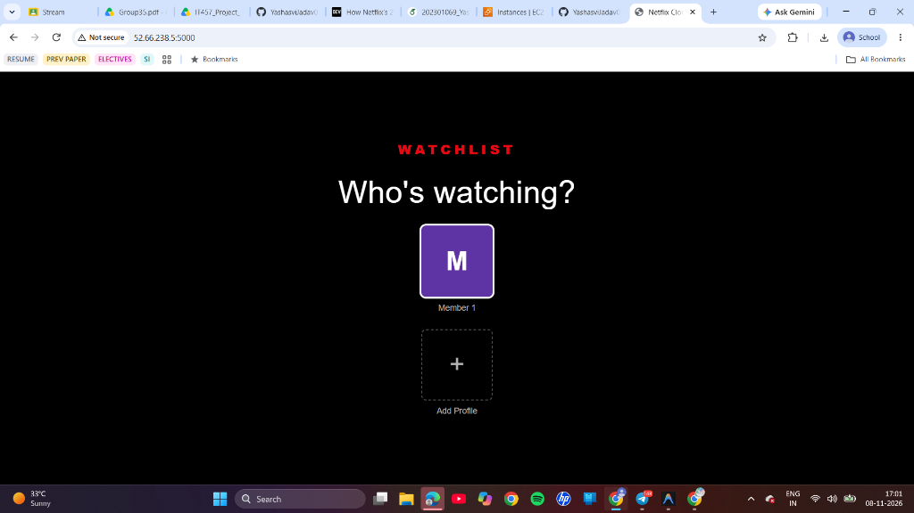
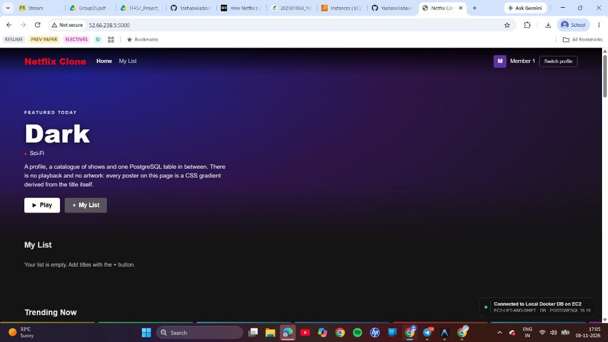

# Lift-and-Shift Cloud VM Deployment Guide (Step 2)
**Course:** IT457 Cloud Computing | **Group:** 35  
**Assignee:** Member 2 (Cloud Infrastructure Lead)  
**Deliverable Checkpoint:** Deliverable 1 — Working App Running on a Cloud VM (Lift-and-Shift)

---

## 1. Overview
This document covers **Step 2** of the migration project: deploying both the 2-tier web application and its backing relational database container as-is onto a single Cloud Virtual Machine (AWS EC2 Ubuntu 22.04 LTS).

---

## 2. Architecture & Characteristics

```
Internet Client
      │
      ▼ (HTTP Port 5000 via netflix-ec2-sg)
┌────────────────────────────────────────────────────────┐
│ AWS EC2 Instance (t2.micro / t3.micro Ubuntu 22.04)    │
│                                                        │
│   ┌────────────────────────┐                           │
│   │ App Container: Flask   │                           │
│   │ (Port 5000)            │                           │
│   └───────────┬────────────┘                           │
│               │ (Internal Docker Bridge)               │
│   ┌───────────▼────────────┐                           │
│   │ DB Container: Postgres │                           │
│   │ (Port 5432 - Internal) │                           │
│   └───────────┬────────────┘                           │
│               │                                        │
│   ┌───────────▼────────────┐                           │
│   │ Local Docker Volume    │                           │
│   │ (ec2_pgdata on EBS)    │                           │
│   └────────────────────────┘                           │
└────────────────────────────────────────────────────────┘
```

### Key Architectural Characteristics
1. **Unaltered Container Packaging:** Both the application code and database schema run from identical container images as used in local development.
2. **Co-location of Compute and State:** Both tiers share the instance's 1 vCPU and 1 GB RAM.
3. **Internal Networking:** The PostgreSQL port (5432) is accessible only through Docker's internal bridge; it is not published to the public internet.
4. **Single Point of Failure (SPOF):** Any disruption to the host EC2 VM or its database container immediately incapacitates the entire service.

---

## 3. Step-by-Step Deployment Instructions

### 1. SSH into the EC2 Instance
```bash
ssh -i netflix-key.pem ubuntu@<EC2-PUBLIC-IP>
```

### 2. Clone the Repository
```bash
git clone https://github.com/YashasviJadav03/IT457_Group35_Netflix_Case_Study.git netflix-app
cd netflix-app
git checkout infra/ec2-lift-shift
```

### 3. Configure the Environment
```bash
cp .env.example .env
sed -i 's/DEPLOYMENT_ENV=Local-Docker/DEPLOYMENT_ENV=EC2-Lift-and-Shift/' .env
```

### 4. Launch the Containers
```bash
docker compose -f docker-compose.ec2.yml up -d --build
```

### 5. Verify Running State
```bash
docker compose -f docker-compose.ec2.yml ps
```
Both `netflix-liftshift-web` and `netflix-liftshift-db` should report `Up (healthy)`.

---

## 4. Verification & Deliverable 1 Verification
- **Web URL:** `http://52.66.238.5:5000`
- **Expected Status Pill:** Green indicator displaying `"Connected to Local Docker DB on EC2"`.
- **Functionality Tested:**
  - Selected profile ("Member 1") on the initial profile gate.
  - Browsed Netflix catalog and featured titles ("Dark", "Narcos", etc.).
  - Added and toggled items in user watchlist.
  - Refreshed page to confirm database persistence on the attached EBS volume.

### Deliverable 1 Evidence (Screenshots)

#### 1. Netflix Profile Gate (`Who's Watching?`)


#### 2. Live Cloud VM Application with Green Database Status Pill


> **Submission Verification:** The screenshot above displays the application executing at public IP `52.66.238.5:5000` with the bottom-right status pill displaying **`Connected to Local Docker DB on EC2`** (green), successfully fulfilling **Final Deliverable 1 (Lift-and-Shift on Cloud VM)**.

