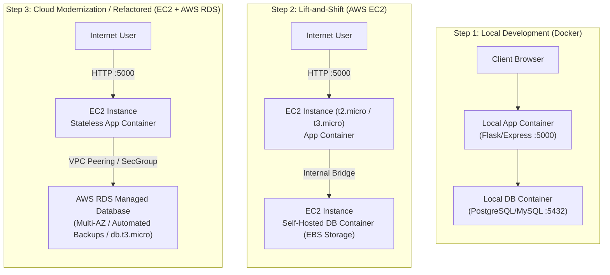
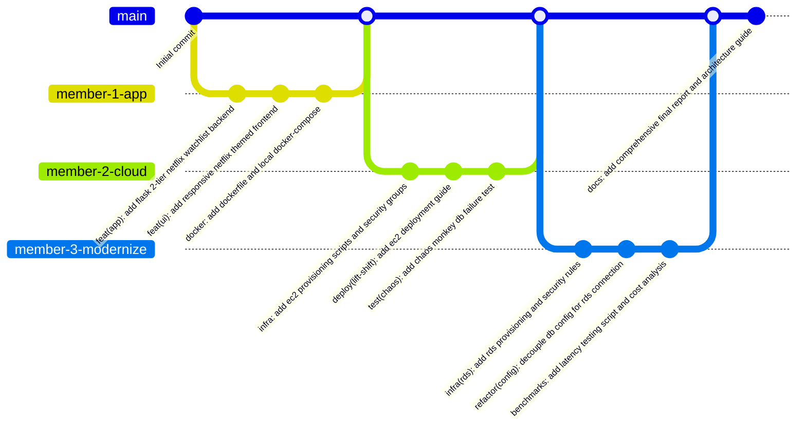

# Netflix AWS Migration & Modernization Project Plan
**Course:** IT457 Cloud Computing | **Group:** 35  
**Theme:** Migration & Transformation (Netflix, Capital One) — Lift-and-Shift to Cloud Modernization & Resilience (Chaos Monkey)

---

## 1. Project Overview & Architecture Evolution

This project demonstrates the enterprise cloud journey from an on-premises / local containerized deployment to a cloud virtual machine (**Lift-and-Shift**) and subsequently to a managed cloud database service (**Cloud Modernization / Refactoring**). The project incorporates resilience testing inspired by Netflix's Chaos Monkey and a comprehensive Total Cost of Ownership (TCO) comparison.

### System Architecture Evolution



---

## 2. Team Member Roles & Work Distribution

To maintain equal contribution and clear Git commit histories among the 3 group members:

| Member | Primary Role | Domain Responsibilities |
| :--- | :--- | :--- |
| **Member 1** | **Application & Local Container Lead** | • Core 2-tier web application (Netflix Watchlist/Profiles UI + API)<br>• Database schemas and local Docker Compose configuration<br>• Initial test data and local validation scripts |
| **Member 2** | **Cloud VM & Lift-and-Shift Lead** | • AWS EC2 provisioning, VPC, Security Group configurations<br>• Lift-and-Shift deployment (App + DB on single EC2 VM)<br>• Chaos Monkey failure simulation (EC2 DB kill vs Recovery) |
| **Member 3** | **Cloud Modernization & Analytics Lead** | • AWS RDS setup (PostgreSQL / MySQL) & parameter configuration<br>• Database migration scripts & App environment refactoring<br>• Performance benchmarking (latency tests) & AWS Cost/TCO calculation |

---

## 3. Chronological Step-by-Step Implementation Guide

Follow these exact steps from scratch.

### Phase 0: Prerequisites & Tooling Setup
*Performed before writing code.*

1. **Local Workstation Tools:**
   - Install **Docker Desktop** (ensure Docker daemon is running).
   - Install **Git** and configure user details (`git config user.name`, `git config user.email`).
   - Install **Python 3.10+** (or Node.js LTS).
   - Install **AWS CLI** (optional but recommended for automated scripting).
   - Install an HTTP benchmarking tool (e.g., `Apache Bench (ab)`, `wrk`, or Python `locust`).
2. **AWS Account Preparation:**
   - Ensure access to an AWS Free Tier eligible account.
   - Select a primary region (e.g., `us-east-1` or `ap-south-1`).
   - Create an EC2 Key Pair (`.pem` format) named `netflix-case-study-key.pem`.

---

### Phase 1: Local 2-Tier Application Setup (Local Docker)

1. **Application Concept (Netflix Watchlist & Profiles):**
   - Simple 2-tier app allowing users to:
     - View a list of Netflix movies / series.
     - Add their user profile name and favorite movie/show to a watchlist.
     - View all saved entries with timestamp and database connection status banner.
2. **Database Initialization:**
   - Database: **PostgreSQL** (or MySQL).
   - File `init.sql`: Creates table `watchlist` with columns `id`, `user_name`, `title`, `genre`, `created_at`.
3. **Containerization:**
   - `Dockerfile`: Multi-stage or lightweight image running Python Flask / Express.
   - `docker-compose.yml`:
     - Service `web`: ports `5000:5000`, depends on `db`, reads DB credentials from `.env`.
     - Service `db`: image `postgres:15-alpine`, mounted volume for local data persistence.
4. **Local Verification:**
   - Run `docker compose up --build -d`.
   - Open `http://localhost:5000`, submit a test entry ("Member 1 - Stranger Things").
   - Confirm record persisted in containerized database.

---

### Phase 2: Cloud VM Setup & Phase A: Lift-and-Shift to AWS EC2

1. **AWS EC2 Configuration:**
   - **AMI:** Ubuntu Server 22.04 LTS (HVM), SSD Volume Type.
   - **Instance Type:** `t2.micro` or `t3.micro` (Free tier eligible).
   - **Security Group (`netflix-ec2-sg`):**
     - Inbound Rule 1: SSH (Port 22) -> My IP (or `0.0.0.0/0` for testing).
     - Inbound Rule 2: Custom TCP (Port 5000) -> Anywhere (`0.0.0.0/0`).
     - Inbound Rule 3: HTTP (Port 80) -> Anywhere (`0.0.0.0/0`).
2. **Provisioning Software on EC2:**
   - SSH into EC2 instance:
     ```bash
     ssh -i netflix-case-study-key.pem ubuntu@<EC2-PUBLIC-IP>
     ```
   - Install Docker & Docker Compose plugin on Ubuntu:
     ```bash
     sudo apt-get update
     sudo apt-get install -y docker.io docker-compose-v2
     sudo usermod -aG docker ubuntu
     ```
3. **Executing Lift-and-Shift:**
   - Clone the GitHub repository directly onto the EC2 instance:
     ```bash
     git clone <REPO_URL> netflix-app
     cd netflix-app
     ```
   - Start the identical multi-container stack:
     ```bash
     docker compose -f docker-compose.yml up -d --build
     ```
4. **Verification & Deliverable 1 Checkpoint:**
   - Open `http://<EC2-PUBLIC-IP>:5000` in browser.
   - Verify web interface loads and successfully writes/reads from the DB container on the same VM.
   - **Take Screenshot 1:** Working app in browser showing URL with EC2 Public IP and DB connection status: "Connected to Local Docker DB on EC2".

---

### Phase 3: Phase B: Cloud Modernization / Refactoring (AWS RDS)

> **Clarification: Is there any code change in the web app?**  
> **No application code rewrite is required** if the app follows the **12-Factor App principle (Config in Environment)**.  
> The web application simply reads `DB_HOST`, `DB_PORT`, `DB_USER`, `DB_PASSWORD`, `DB_NAME` from environment variables. During refactoring:
> 1. Web code remains 100% identical.
> 2. `docker-compose.yml` (or `.env`) on EC2 is updated: the `db` service container is stopped, and `DB_HOST` is changed from the local Docker service name `db` to the AWS RDS Endpoint URL (`xxxx.rds.amazonaws.com`).

1. **AWS RDS Provisioning:**
   - **Engine:** PostgreSQL (matching local version, e.g., PostgreSQL 15).
   - **Template:** Free Tier.
   - **DB Instance Class:** `db.t3.micro` or `db.t4g.micro` (1 vCPU, 1 GB RAM, 20 GB gp2 storage).
   - **Settings:**
     - DB Identifier: `netflix-cloud-db`
     - Master Username: `postgresadmin`
     - Master Password: `<secure-password>`
     - Initial Database Name: `netflix_db`
   - **Connectivity & VPC:**
     - Same VPC as EC2 instance.
     - Public access: No (private subnet) or Yes (with restricted security group).
     - **RDS Security Group (`netflix-rds-sg`):**
       - Inbound Rule: PostgreSQL (Port 5432) -> Source: `netflix-ec2-sg` (Security Group ID of EC2). This guarantees secure internal traffic.
2. **Data Migration (Lift-and-Shift DB -> RDS):**
   - Dump data from local container on EC2:
     ```bash
     docker exec -t <db-container-id> pg_dump -U postgres netflix_db > backup.sql
     ```
   - Restore data into AWS RDS:
     ```bash
     psql -h <RDS-ENDPOINT> -U postgresadmin -d netflix_db -f backup.sql
     ```
3. **Reconfiguring the Web Application:**
   - Stop the local DB container on the VM:
     ```bash
     docker stop <db-container-name>
     ```
   - Update production environment file (`.env.production`):
     ```env
     DB_HOST=<RDS-ENDPOINT>
     DB_PORT=5432
     DB_NAME=netflix_db
     DB_USER=postgresadmin
     DB_PASSWORD=<secure-password>
     DEPLOYMENT_ENV=AWS-RDS-Refactored
     ```
   - Restart the app container with the new configuration:
     ```bash
     docker compose -f docker-compose.prod.yml up -d --build web
     ```
4. **Verification & Deliverable 2 Checkpoint:**
   - Refresh `http://<EC2-PUBLIC-IP>:5000`.
   - Confirm web app banner shows: "Connected to Managed Database: AWS RDS".
   - Submit new records, verify persistence across EC2 app restarts.
   - **Take Screenshot 2:** Browser showing EC2 IP connected to AWS RDS endpoint.

---

### Phase 4: Chaos Engineering Experiment (Chaos Monkey Simulation)

To demonstrate the core Netflix case study value proposition (resilience and high availability):

1. **Experiment 1: Local DB Crash on Single VM (Lift-and-Shift Vulnerability)**
   - Simulate sudden DB crash: `docker kill <db-container-id>` on EC2.
   - **Result:** Web application immediately crashes with 500 error / connection refused. All writes fail. Potential risk of EBS data corruption if the VM crashes. Recovery requires manual SSH intervention.
2. **Experiment 2: Managed Database Resilience (RDS Modernization)**
   - Simulate VM restart: `sudo reboot` on EC2.
   - **Result:** EC2 reboots, app container comes back up automatically (`restart: always`), and reconnects to RDS instantly with **zero data loss**.
   - Simulate database reboot / Multi-AZ failover from AWS RDS console:
     - Click **Actions -> Reboot with failover**.
     - Observe RDS automated health monitoring and seamless IP reassignment.
   - **Document in Report:** Differentiate single-point-of-failure (Lift-and-Shift) vs cloud-native separation of concerns (Refactored).

---

### Phase 5: Metrics, Cost & Effort Comparison Matrix

Collect real measurements to satisfy Deliverable 3:

#### 1. Performance & Latency Measurements
Run an automated benchmark (500 requests, 10 concurrent clients) using `ab` or Python script:
```bash
ab -n 500 -c 10 http://<EC2-IP>:5000/api/watchlist
```

| Metric | Phase 1 (Local Docker) | Phase 2 (Lift-and-Shift on EC2) | Phase 3 (Refactored: EC2 + RDS) |
| :--- | :--- | :--- | :--- |
| Average Latency (ms) | ~5 - 15 ms | ~8 - 20 ms | ~15 - 35 ms (VPC network hop) |
| Requests / Sec (Throughput) | High | Moderate (VM resource contention) | High (Dedicated DB compute) |
| Availability under DB stress | Low (VM CPU throttle) | Low (DB crash kills VM RAM) | High (Isolated blast radius) |

#### 2. Cost Analysis (AWS Pricing Calculator — US East N. Virginia)

| Cost Component | Option A: Lift-and-Shift (Single EC2) | Option B: Modernized (EC2 + AWS RDS) |
| :--- | :--- | :--- |
| **Compute** | 1x `t3.small` (2 vCPU, 2GB RAM): **\$15.18/mo** | 1x `t3.micro` for App: **\$7.59/mo** |
| **Database** | Self-hosted on EC2 (Included in VM) | 1x `db.t3.micro` RDS Single-AZ: **\$12.41/mo** |
| **Storage & Backups** | 30 GB EBS gp3: **\$2.40/mo** + manual snapshot costs | 20 GB RDS gp2: **\$2.30/mo** + automated snapshots included |
| **Total Monthly Cost** | **\$17.58 / month** (Free tier: \$0 for 12 mos) | **\$22.30 / month** (Free tier: \$0 for 12 mos) |
| **Maintenance Effort** | **High** (Manual OS patches, manual DB backups, zero failover) | **Very Low** (Managed patching, auto-backups, point-in-time recovery) |

---

## 4. Academic Report & Deliverable Alignment

- **Week 1 Deliverable:** *(Submitted)* Architecture & primary case study background.
- **Week 2 Deliverable (10-Page Report):**
  - Section 1: Executive Summary & Netflix Migration History (2008 datacenter outage to AWS).
  - Section 2: Lift-and-Shift vs Modernization Strategy.
  - Section 3: Architecture Diagrams (Local -> EC2 Lift-and-Shift -> EC2+RDS Refactored).
  - Section 4: Chaos Engineering & The Simian Army (Chaos Monkey).
  - Section 5: Step-by-Step Exercise Implementation Plan.
  - Section 6: Team Roles, Governance, and Git Branching Strategy.
- **Week 3 Deliverable (Results Add-On):**
  - Latency and throughput benchmark charts.
  - Chaos failure logs (EC2 container kill vs RDS failover).
  - AWS cost breakdown tables and ROI analysis.
- **Week 4 Deliverable (Final Report):**
  - Consolidated final technical report including screenshots, conclusion, and operational post-mortem.

---

## 5. Granular GitHub Commit Plan (Sequential & Distributed)

This commit timeline ensures an even distribution across all 3 members on GitHub with descriptive commit messages and structured branch workflows.



### Commit Schedule Table

| # | Author / Assignee | Branch | Commit Message | Files Changed / Added | Purpose & Deliverable Link |
| :---: | :--- | :--- | :--- | :--- | :--- |
| **01** | **Member 1** | `feat/app-backend` | `feat(backend): initialize 2-tier application with postgres connector` | `app.py`, `requirements.txt`, `init.sql`, `.gitignore` | Sets up Flask web service, DB schema for watchlist items, and REST endpoints. |
| **02** | **Member 1** | `feat/app-backend` | `feat(frontend): create netflix-themed ui for watchlist management` | `templates/index.html`, `static/style.css`, `static/app.js` | Dark Netflix-themed UI, form to add user profile & favorite shows, status banner displaying active DB engine. |
| **03** | **Member 1** | `feat/app-backend` | `docker: add dockerfile and local multi-container docker-compose` | `Dockerfile`, `docker-compose.yml`, `.env.example` | Completes **Step 1 (Local 2-tier app in Docker)**. Verified with `docker compose up`. |
| **04** | **Member 2** | `infra/ec2-lift-shift` | `infra(ec2): add ec2 setup script and security group configuration` | `scripts/setup_ec2.sh`, `docs/aws_ec2_setup.md` | Shell script to automate Docker installation and firewall rules for EC2. |
| **05** | **Member 2** | `infra/ec2-lift-shift` | `deploy(lift-and-shift): configure compose for single ec2 vm deployment` | `docker-compose.ec2.yml`, `docs/lift_and_shift_deployment.md` | Completes **Step 2 (Lift-and-Shift onto single VM)**. Deploys both app and DB container to EC2. |
| **06** | **Member 2** | `infra/ec2-lift-shift` | `test(chaos): add chaos monkey container failure simulation script` | `scripts/chaos_monkey.sh`, `docs/chaos_experiment_results.md` | Automates killing the DB container to record downtime and blast radius on the Lift-and-Shift architecture. |
| **07** | **Member 3** | `infra/rds-refactor` | `infra(rds): document rds postgresql provisioning and vpc peering` | `docs/aws_rds_setup.md`, `scripts/migrate_to_rds.sh` | Instructions and automated `pg_dump/psql` script to migrate data from EC2 container into AWS RDS. |
| **08** | **Member 3** | `infra/rds-refactor` | `refactor(db-cloud): add dynamic configuration for aws rds managed database` | `docker-compose.prod.yml`, `.env.production.example`, `app.py` | Completes **Step 3 & 4 (Refactor to Managed DB)**. Connects stateless app container to AWS RDS endpoint without code rewrite. |
| **09** | **Member 3** | `infra/rds-refactor` | `benchmarks: add latency benchmarking tool and cost-effort comparison matrix` | `benchmarks/run_benchmarks.py`, `docs/cost_effort_analysis.md` | Completes **Step 5 (Document experience & cost comparison)**. Latency test data and monthly TCO calculator. |
| **10** | **Collaborative** (All 3) | `main` | `docs(final): add consolidated project report, architecture diagrams, and submission ready docs` | `README.md`, `docs/Week2_Project_Report.md`, `docs/Week4_Final_Report.md` | Final project documentation, architecture diagrams, execution screenshots, and submission artifacts. |

---

## 6. Checklist Before Final Submission

- [ ] Local 2-tier app runs with `docker compose up` on `localhost:5000`.
- [ ] EC2 instance deployed and accessible on public IP.
- [ ] Lift-and-Shift running: both web app and DB container hosted on EC2. Screenshot captured.
- [ ] AWS RDS instance created and reachable only from EC2 security group.
- [ ] Data migrated from local container to RDS.
- [ ] Web app reconfigured to point to RDS endpoint. Screenshot captured.
- [ ] Chaos Monkey experiment executed, downtime recorded.
- [ ] Latency benchmark numbers documented.
- [ ] Cost comparison table populated with exact AWS Pricing Calculator figures.
- [ ] All 10 Git commits pushed with appropriate member attributions.


---

## 7. Implementation Notes (as built)

This section records what the local two-tier application actually contains, verified against the code and files in the repository. Where the plan, the commit table, the earlier interface discussion or the pre-submission checklist describes something different, the difference is stated explicitly in 7.1.

### 7.1 Differences from the plan and the handoff section

| Item | Plan / handoff said | As built | Impact on teammates |
| :--- | :--- | :--- | :--- |
| HTTP API surface | Only `/api/watchlist` is named (as the `ab` benchmark target); no endpoint list | `GET /`, `GET /health`, `GET /api/status`, `GET /api/catalog`, `GET /api/watchlist`, `POST /api/watchlist`, `DELETE /api/watchlist/<int:entry_id>` | Poll `/health` for uptime, benchmark `/api/watchlist`, and note that test rows can be deleted. |
| Delete support | Earlier interface discussion specified no DELETE endpoint and no delete control | DELETE is implemented: `200 {"deleted": <id>}`, `404 {"error": "entry not found"}`, `500 {"error": "database unavailable"}`. The card `+` button toggles add/remove and My List cards carry a `✕` button | Cleanup and chaos scripts can remove rows; do not document the watchlist as append-only. |
| Request / response shapes | Not specified in the plan | `GET /api/watchlist` → `{"count": n, "entries": [ ... ]}`, entry keys `id, user_name, title, genre, created_at`; `GET /api/catalog` → `{"titles": [ ... ]}`; `POST /api/watchlist` → `201` with the created entry; `GET /api/status` → `connected, message, deployment_env, db_host, db_engine, error`; `GET /health` → `200 {"status": "healthy", "database": "connected"}` or `500 {"status": "unhealthy", "database": "unreachable", "error": "<first line of driver error>"}` | Every error body is a flat `{"error": "<text>"}`; there are no field-level error objects to parse. |
| Status codes | Plan implies failures produce 500s but defines no contract | `/` always 200; `/health` 200 or 500; `/api/status` always 200; `GET /api/watchlist` 200 or 500; POST 201, 400 or 500; DELETE 200, 404 or 500; a non-integer DELETE path such as `/api/watchlist/abc` returns Flask's HTML 404, not JSON | Uptime checks should key off `/health` only; treat a non-JSON 404 as a routing miss. |
| Environment variables | `DB_HOST`, `DB_PORT`, `DB_NAME`, `DB_USER`, `DB_PASSWORD`, `DEPLOYMENT_ENV` | A seventh variable exists: `DB_SSLMODE` (default `prefer`) | Required for RDS: `DB_SSLMODE=require`, or the managed instance may reject the connection. |
| Environment defaults | Not specified | In code: `DB_HOST=localhost`, `DB_PORT=5432`, `DB_NAME=netflix_db`, `DB_USER=postgres`, `DB_PASSWORD=` (empty), `DB_SSLMODE=prefer`, `DEPLOYMENT_ENV=Local-Docker`. `.env.example` ships `DB_HOST=db` and `DB_PASSWORD=change_me_please` | Inside a container `localhost` is the container itself, so the compose `web` service must keep `DB_HOST=db` until RDS is configured. |
| Status label wording | Phase 2 and Phase 3 screenshots expect "Connected to Local Docker DB on EC2" and "Connected to Managed Database: AWS RDS" | Exactly those strings are produced for `EC2-Lift-and-Shift` and `AWS-RDS-Refactored`; `Local-Docker` produces "Connected to Local Docker DB"; any other value produces "Connected to database (<value>)"; an unreachable database produces "Database connection FAILED" | `DEPLOYMENT_ENV` must match one of the three built-in names character for character, including hyphens and capitals, or the screenshot wording will differ. |
| Port mapping | `5000:5000` | `docker-compose.yml` publishes `${WEB_PORT:-5000}:5000`, so the host port defaults to 5000 and is changed through the `WEB_PORT` variable (in `.env` or the shell) without editing committed files; the container always listens on 5000. Local verification ran with `WEB_PORT=5055` because port 5000 is held by the macOS AirPlay Receiver | No override file is needed. Any firewall or security group, including `netflix-ec2-sg`, must allow the selected host port; the container port stays 5000. |
| Healthchecks | Not specified ("confirm the container is healthy") | `db`: `pg_isready -U $POSTGRES_USER -d $POSTGRES_DB`, interval 5s, timeout 5s, retries 10, start period 10s. `web`: a Python standard-library GET of `http://127.0.0.1:5000/health` with a 3s timeout, interval 15s, timeout 5s, retries 3, start period 15s. `web` starts only after `db` reports healthy (`depends_on: condition: service_healthy`) | `docker compose ps` reports `web` as unhealthy whenever PostgreSQL is down, by design; the container itself keeps running and recovers when the database returns. |
| Gunicorn settings | "Running Python Flask"; no server settings | `gunicorn --bind 0.0.0.0:5000 --workers 2 --timeout 30 --access-logfile - --error-logfile - app:app` | Two workers on a 1 GB `t3.micro` leave little headroom under `ab -c 10`; increase only with more memory. Logs go to stdout/stderr, so `docker compose logs` is the only place to read them. |
| Dockerfile | "Multi-stage or lightweight", Python 3.10+ | Single-stage `python:3.11-slim`, `PYTHONDONTWRITEBYTECODE=1`, `PYTHONUNBUFFERED=1`, `PIP_NO_CACHE_DIR=1`; dependencies installed before the source copy; non-root `appuser` with uid 10001; `EXPOSE 5000`; `.env` excluded by `.dockerignore` | Not a multi-stage build. If a multi-stage requirement is graded, that is still to do. The non-root user must have access to any path mounted into the container. |
| Compose services and volume | Services `web` and `db`, "mounted volume for local data persistence" | Services `web` (built from `.`) and `db` (`postgres:15-alpine`); named volume key `pgdata`; both `restart: always`; the database port is not published to the host; `init.sql` mounted read-only at `/docker-entrypoint-initdb.d/init.sql`; `web` uses `env_file: .env`; `db` takes `POSTGRES_*` from `${...}` substitution | The real Docker volume is `<directory-name>_pgdata` (currently `it457_group35_netflix_case_study_pgdata`). Cloning into a different directory creates a new empty volume, so data appears to vanish. |
| Seed data | Not specified | `init.sql` inserts four rows (`Member 1` twice, `Demo User` twice) guarded by `WHERE NOT EXISTS (SELECT 1 FROM watchlist)`, so it is idempotent and only runs on a fresh volume | Benchmark baselines and screenshots start with four rows. Delete them or run `docker compose down -v` for a clean table. |
| Catalogue source | "View a list of Netflix movies / series" | Twelve titles hardcoded in `CATALOG` inside `app.py`, each with a genre; nothing is stored in PostgreSQL | Editing the catalogue requires a code change and an image rebuild. `/api/catalog` works with the database down. |
| Frontend concept | Commit 02 describes "form to add user profile & favorite shows" and a status banner listing the active DB engine | No form. The page is a profile gate ("Who's watching?"), a fixed navbar with the wordmark "Netflix Clone", a hero, My List / Trending Now / one row per genre, hover-expanding cards, a detail modal, a toast, and a fixed bottom-right database status pill | Do not reference a watchlist form in the report or README; the commit 02 message no longer describes the code. |
| Element IDs | The earlier interface draft used a form-based markup with ids such as `#watchlist-form`, `#user_name`, `#title`, `#genre` and `#form-message` | None of those exist. Present: `#boot-data`, `#profile-gate`, `#profile-list`, `#add-profile-btn`, `#profile-form-panel`, `#new-profile-name`, `#save-profile-btn`, `#cancel-profile-btn`, `#profile-error`, `#app-root`, `#navbar`, `#nav-profile-name`, `#nav-avatar`, `#nav-mylist`, `#switch-profile-btn`, `#hero`, `#hero-title`, `#hero-genre`, `#hero-add-btn`, `#hero-play-btn`, `#db-banner`, `#banner-label`, `#banner-message`, `#banner-details`, `#rows`, `#row-mylist`, `#row-trending`, `#modal`, `#modal-content`, `#modal-title`, `#modal-add-btn`, `#toast` | Any script, test or document quoting form-oriented selectors must be rewritten. |
| Identity and profiles | User profile name supplied with each entry | Profiles live only in the browser: `localStorage` keys `watchlist_profiles` (JSON array) and `watchlist_active_profile` (string), default profile `Member 1`. The server stores only `user_name` on the row; there is no users table and no authentication | Profiles are per browser and do not sync. Any `user_name` can be written by any caller. |
| Refresh behaviour | Not specified | `/api/status` polled every 10 s, `/api/watchlist` refetched every 30 s; the page reflects database changes without a reload | Wait at least ten seconds before judging the status pill in a test or screenshot. |
| Validation rules | Not specified | POST requires `user_name` (≤ 100 characters) and `title` (≤ 200 characters); `genre` is optional and stored as `NULL` when blank; error texts are `user_name is required`, `title is required`, `user_name must be at most 100 characters`, `title must be at most 200 characters` | Display `error` verbatim; there is no per-field error structure. |
| Genre length | Not specified | No application-level check. The column is `VARCHAR(50)`, so a longer genre is rejected by PostgreSQL and the endpoint answers `500 {"error": "database unavailable"}` (verified with a 60-character genre) | Keep genres ≤ 50 characters, or accept a misleading 500 in tests. |
| Duplicate titles | Not specified | Permitted: no unique constraint, and two identical POSTs return 201 and create two rows (verified). The UI prevents adding the same title twice for one profile and collapses duplicates in My List | Row counts can exceed distinct titles; DELETE removes one row by id. |
| Behaviour when the database is down | Plan Phase 4 states the web application "immediately crashes with 500 error / connection refused" | `/` still returns 200, renders the hardcoded catalogue, shows "Database unavailable" in place of My List, toasts the API error on add/remove, and turns the status pill red; only database-backed calls return 500 | Adjust the chaos narrative: the page degrades and keeps serving, it does not crash. |
| Commit plan and file list | Commits 01–03 list `app.py`, `requirements.txt`, `init.sql`, `.gitignore`, the three frontend files, `Dockerfile`, `docker-compose.yml`, `.env.example` | The working tree also contains `.dockerignore`, `scripts/validate_local.sh`, `README.md` and `plan.md`. `docker-compose.ec2.yml`, `docker-compose.prod.yml`, `.env.production.example`, `scripts/setup_ec2.sh`, `scripts/chaos_monkey.sh`, `scripts/migrate_to_rds.sh`, `benchmarks/` and `docs/` are not implemented | Members 2 and 3 still own all EC2, RDS and benchmark artifacts; nothing can be reused from this repository yet. |
| Repository state | Commits 01–03 on `feat/app-backend` (commit table) or `member-1-app` (commit graph) | The twelve files plus `README.md` and `plan.md` exist and are **uncommitted**; `git status` lists them as untracked on `main` | Do not assume these files are on a shared branch or pushed remote. Coordinate the first commit before branching for EC2 work. |
| Benchmark target | `ab -n 500 -c 10 http://<EC2-IP>:5000/api/watchlist` | The path exists and runs one `SELECT ... ORDER BY created_at DESC, id DESC LIMIT 100`; each request opens and closes its own PostgreSQL connection (no pool) | Throughput and latency include connection setup cost. Describe that as intentional rather than as a bug. |
| Runtime language | "Python Flask / Express" and "Python 3.10+ (or Node.js LTS)" | Python 3.11 only: Flask 3.0.3, psycopg2-binary 2.9.9, gunicorn 22.0.0, all pinned in `requirements.txt` | No Node.js component exists; the frontend is static HTML, CSS and ES5-style JavaScript served by Flask. |

### 7.2 Files as built

| Path | Purpose |
| :--- | :--- |
| `app.py` | Flask application: configuration from environment, per-request PostgreSQL connection, catalogue data, validation, existing routes `/`, `/health`, `/api/status`, `/api/catalog`, `/api/watchlist` (GET, POST, DELETE). |
| `requirements.txt` | Pinned Python dependencies: Flask 3.0.3, psycopg2-binary 2.9.9, gunicorn 22.0.0. |
| `init.sql` | Creates the `watchlist` table (`id`, `user_name`, `title`, `genre`, `created_at`) and seeds four starter rows; executed by the PostgreSQL image only when the data volume is empty. |
| `templates/index.html` | Single page shell: embedded `#boot-data` JSON (catalogue and status), profile gate, navbar, hero, rows, entry modal, toast, database status pill. |
| `static/style.css` | All styling: layout, Netflix-style cards and hover expansion, modal, toast, status pill states, responsive rules down to 375 px, reduced-motion handling. |
| `static/app.js` | Browse logic: profile storage, row rendering, add/remove toggle, modal with focus trap, catalogue filtering, status and watchlist polling. |
| `Dockerfile` | `python:3.11-slim` image, non-root `appuser`, gunicorn entry point, container healthcheck against `/health`. |
| `docker-compose.yml` | Two services (`web`, `db`), named volume `pgdata`, healthchecks, `restart: always`, `env_file: .env`, `init.sql` mounted into the database container. |
| `.env.example` | Documented template for every environment variable (purpose, default, example), including the RDS and TLS notes and the compose-only `WEB_PORT` setting. |
| `.dockerignore` | Keeps the virtualenv, `.git`, `.env`, caches and editor files out of the build context. |
| `.gitignore` | Keeps `.env`, virtualenvs, Python caches and OS/editor files out of version control. |
| `scripts/validate_local.sh` | Seven HTTP checks (page, health, status, catalogue, add, list, delete with its 404 path); exits non-zero on the first failure. |
| `README.md` | Repository title only; contains no usage instructions. |
| `plan.md` | This plan; section 7 is the record of what was built. |

Not present, and therefore not implemented: `docker-compose.ec2.yml`, `docker-compose.prod.yml`, `.env.production.example`, `scripts/setup_ec2.sh`, `scripts/chaos_monkey.sh`, `scripts/migrate_to_rds.sh`, `benchmarks/`, `docs/`.

### 7.3 Exact commands

Service names are `web` and `db`. The Docker Compose project name is derived from the directory name, so container names here are `it457_group35_netflix_case_study-web-1` and `it457_group35_netflix_case_study-db-1`; the data volume is `it457_group35_netflix_case_study_pgdata`. Service-based commands (`docker compose exec db ...`) work regardless of container names.

The published host port is configuration, not a fixed value: the mapping is `${WEB_PORT:-5000}:5000`, so `WEB_PORT` changes only the host side while the container keeps listening on 5000 (see 8.2). The commands below assume the default 5000; substitute `http://localhost:5055` or whichever value is set when using another host port.

```bash
# Start on the default host port 5000 (builds the image if needed)
docker compose up --build -d

# Start on another host port, for example when port 5000 is already in use
WEB_PORT=5055 docker compose up --build -d

# Check health
docker compose ps
curl -s http://localhost:5000/health        # use :5055 when WEB_PORT=5055

# Logs
docker compose logs -f web
docker compose logs -f db
docker compose logs --tail=100 web

# Stop containers, keep containers and data
docker compose stop

# Stop and remove containers and the network, keep the volume
docker compose down

# Full reset: remove containers, network and the database volume
docker compose down -v
# Deletes it457_group35_netflix_case_study_pgdata.
# The next "docker compose up" re-runs init.sql, so the table and the four seed rows return.

# Interactive psql shell inside the database container
docker compose exec db psql -U postgres -d netflix_db

# One-off query (verified)
docker compose exec -T db psql -U postgres -d netflix_db -c "SELECT count(*) FROM watchlist;"

# Dump the database from the database container (verified)
docker compose exec -T db pg_dump -U postgres -d netflix_db > backup.sql

# Restore into an empty database (the dump contains its own CREATE TABLE)
docker compose exec -T db psql -U postgres -d netflix_db < backup.sql

# Recreate only the app container after editing .env
docker compose up -d --force-recreate web

# Local smoke test
bash scripts/validate_local.sh http://localhost:5000
```

Two substitutes must match `.env`: `-U postgres` is `DB_USER`, and `-d netflix_db` is `DB_NAME`; `psql` inside the container authenticates as the `postgres` superuser created by `POSTGRES_USER`.

On this development machine port 5000 is occupied by the macOS AirPlay Receiver, so the local `.env` sets `WEB_PORT=5055` and the stack is reached at `http://localhost:5055`. The same value can be passed on the command line instead:

```bash
WEB_PORT=5055 docker compose up --build -d
bash scripts/validate_local.sh http://localhost:5055
```

Only the host port changes; the container port stays 5000.

### 7.4 Known limitations and assumptions

- **No authentication or authorisation.** Any client that can reach port 5000 can read, add and delete entries. `DELETE` requires only the numeric id.
- **Profiles are browser-local.** Profile names and the active profile exist only in `localStorage` (`watchlist_profiles`, `watchlist_active_profile`); clearing site data removes them. If `localStorage` is unavailable or blocked, the page still works but falls back to the default profile `Member 1` for the session and persists nothing.
- **Duplicate titles are allowed** by the API and the schema. De-duplication is a client-side display rule only.
- **The catalogue is hardcoded** in `app.py` (twelve titles) and is not editable at runtime.
- **`genre` over 50 characters** is not validated and surfaces as `500 {"error": "database unavailable"}`.
- **`/api/watchlist` is capped** at the 100 most recent rows (`ORDER BY created_at DESC, id DESC LIMIT 100`), with no pagination or offset parameter; older rows remain in the table but are not returned.
- **Non-integer DELETE paths** (`/api/watchlist/abc`) return Flask's default HTML 404 rather than a JSON error.
- **No schema migrations.** `init.sql` runs only when the data volume is empty; changing the schema later requires a manual `psql` step or a volume reset.
- **The host port is configuration only.** `WEB_PORT` is read by Docker Compose for the port mapping and is never seen by the application, so no image rebuild or code change is needed to move between 5000 and another port; the container always listens on 5000. A firewall or security group must allow the chosen port.
- **No connection pooling.** A new psycopg2 connection (with `connect_timeout=5`) is opened and closed per request; this is deliberate and affects benchmark numbers.
- **Single-page, no client routing**, no build step and no external assets; fonts fall back to system families.
- **No automated tests** beyond `scripts/validate_local.sh`, which writes and deletes rows in the live database. There are no unit or integration tests.
- **No rate limiting, CSRF protection or TLS.** Traffic is plain HTTP on port 5000; no reverse proxy or port 80 listener is configured.
- **Status label coverage** is limited to three built-in environment names; any other `DEPLOYMENT_ENV` value is shown verbatim inside a generic message.
- **Health failures report only the first line** of the driver error, truncated to 300 characters with any password text scrubbed, which is enough for diagnosis but not a full stack trace.
- **Chaos behaviour is manual.** Failure injection is performed with `docker stop db` (or `docker compose stop db`) and recovery with `docker compose start db`; no script automates it and no downtime is recorded automatically.
- **AWS artifacts are absent.** EC2 provisioning, RDS provisioning, data migration, benchmarks and the cost comparison exist only as plan steps, not as code or documents.

---

## 8. How to Run

### 8.1 Local machine with Docker

1. Create the environment file once and set a real password:
   ```bash
   cp .env.example .env
   # edit DB_PASSWORD in .env
   ```
2. Start the stack (image is built on the first run):
   ```bash
   docker compose up --build -d
   ```
3. Open `http://localhost:<WEB_PORT>`, default `5000`, in a browser.
4. Check that both services are healthy and the API answers:
   ```bash
   docker compose ps
   curl -s http://localhost:<WEB_PORT>/health
   bash scripts/validate_local.sh http://localhost:<WEB_PORT>
   ```
5. Stop the stack:
   ```bash
   docker compose stop        # keeps containers and data
   docker compose down        # removes containers and the network, keeps the volume
   docker compose down -v     # also deletes the database volume
   ```

### 8.2 Choosing the host port

The container always listens on 5000. `WEB_PORT` selects the port published on the host and defaults to 5000, so the mapping is `5000:5000` unless it is set. Any of the following works; no file in the repository needs editing.

- **macOS, where the AirPlay Receiver holds port 5000:**
  ```bash
  WEB_PORT=5055 docker compose up --build -d
  # open http://localhost:5055
  ```
- **Windows (PowerShell):**
  ```powershell
  $env:WEB_PORT = 5055
  docker compose up --build -d
  ```
- **Any operating system, without shell-specific syntax:** put `WEB_PORT=5055` in `.env`, then run `docker compose up --build -d`. Docker Compose reads `.env` for the substitution.
- **A different machine or EC2:** open the same port in the firewall or security group (`netflix-ec2-sg`), then browse to `http://<public-ip>:<WEB_PORT>`.

The value must match in three places: the variable, the URL used for testing, and the firewall or security group rule. The container port is always 5000 and is not configurable.
