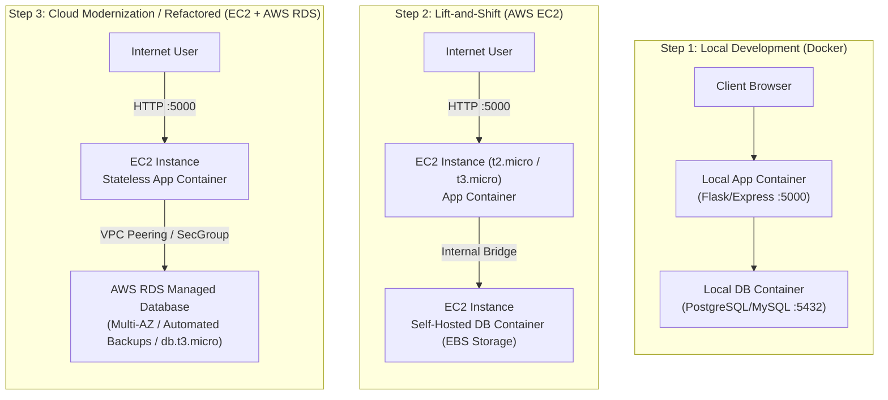
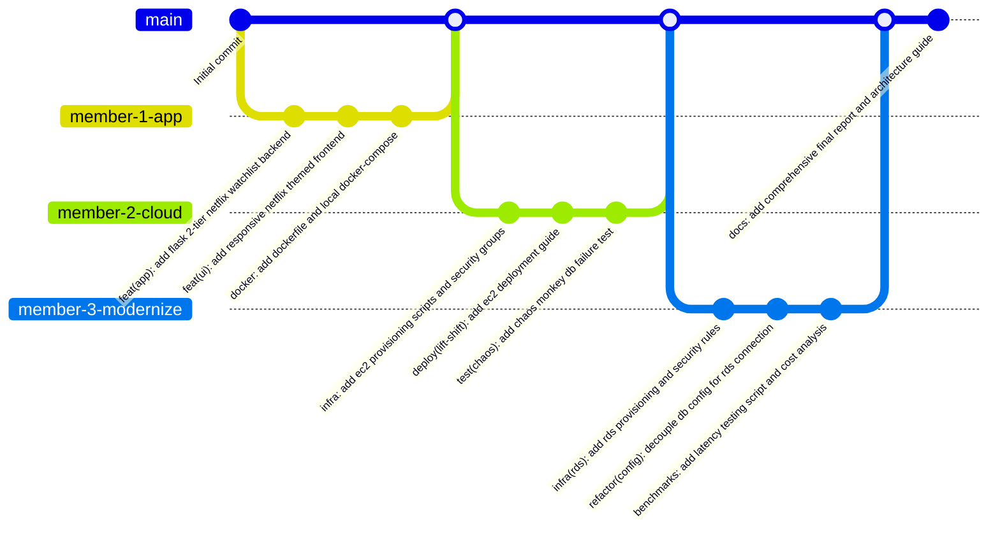

# Netflix AWS Migration & Modernization Project Plan
**Course:** IT457 Cloud Computing | **Group:** 35  
**Theme:** Migration & Transformation (Netflix, Capital One) — Lift-and-Shift to Cloud Modernization & Resilience (Chaos Monkey)

---

## 1. Project Overview & Architecture Evolution

This project demonstrates the enterprise cloud journey from an on-premises / local containerized deployment to a cloud virtual machine (**Lift-and-Shift**) and subsequently to a managed cloud database service (**Cloud Modernization / Refactoring**). The project incorporates resilience testing inspired by Netflix's Chaos Monkey and a comprehensive Total Cost of Ownership (TCO) comparison.

### System Architecture Evolution



---

## 2. Team Member Roles & Work Distribution

To maintain equal contribution and clear Git commit histories among the 3 group members:

| Member | Primary Role | Domain Responsibilities |
| :--- | :--- | :--- |
| **Member 1** | **Application & Local Container Lead** | • Core 2-tier web application (Netflix Watchlist/Profiles UI + API)<br>• Database schemas and local Docker Compose configuration<br>• Initial test data and local validation scripts |
| **Member 2** | **Cloud VM & Lift-and-Shift Lead** | • AWS EC2 provisioning, VPC, Security Group configurations<br>• Lift-and-Shift deployment (App + DB on single EC2 VM)<br>• Chaos Monkey failure simulation (EC2 DB kill vs Recovery) |
| **Member 3** | **Cloud Modernization & Analytics Lead** | • AWS RDS setup (PostgreSQL / MySQL) & parameter configuration<br>• Database migration scripts & App environment refactoring<br>• Performance benchmarking (latency tests) & AWS Cost/TCO calculation |

---

## 3. Chronological Step-by-Step Implementation Guide

Follow these exact steps from scratch.

### Phase 0: Prerequisites & Tooling Setup
*Performed before writing code.*

1. **Local Workstation Tools:**
   - Install **Docker Desktop** (ensure Docker daemon is running).
   - Install **Git** and configure user details (`git config user.name`, `git config user.email`).
   - Install **Python 3.10+** (or Node.js LTS).
   - Install **AWS CLI** (optional but recommended for automated scripting).
   - Install an HTTP benchmarking tool (e.g., `Apache Bench (ab)`, `wrk`, or Python `locust`).
2. **AWS Account Preparation:**
   - Ensure access to an AWS Free Tier eligible account.
   - Select a primary region (e.g., `us-east-1` or `ap-south-1`).
   - Create an EC2 Key Pair (`.pem` format) named `netflix-case-study-key.pem`.

---

### Phase 1: Local 2-Tier Application Setup (Local Docker)

1. **Application Concept (Netflix Watchlist & Profiles):**
   - Simple 2-tier app allowing users to:
     - View a list of Netflix movies / series.
     - Add their user profile name and favorite movie/show to a watchlist.
     - View all saved entries with timestamp and database connection status banner.
2. **Database Initialization:**
   - Database: **PostgreSQL** (or MySQL).
   - File `init.sql`: Creates table `watchlist` with columns `id`, `user_name`, `title`, `genre`, `created_at`.
3. **Containerization:**
   - `Dockerfile`: Multi-stage or lightweight image running Python Flask / Express.
   - `docker-compose.yml`:
     - Service `web`: ports `5000:5000`, depends on `db`, reads DB credentials from `.env`.
     - Service `db`: image `postgres:15-alpine`, mounted volume for local data persistence.
4. **Local Verification:**
   - Run `docker compose up --build -d`.
   - Open `http://localhost:5000`, submit a test entry ("Member 1 - Stranger Things").
   - Confirm record persisted in containerized database.

---

### Phase 2: Cloud VM Setup & Phase A: Lift-and-Shift to AWS EC2

1. **AWS EC2 Configuration:**
   - **AMI:** Ubuntu Server 22.04 LTS (HVM), SSD Volume Type.
   - **Instance Type:** `t2.micro` or `t3.micro` (Free tier eligible).
   - **Security Group (`netflix-ec2-sg`):**
     - Inbound Rule 1: SSH (Port 22) -> My IP (or `0.0.0.0/0` for testing).
     - Inbound Rule 2: Custom TCP (Port 5000) -> Anywhere (`0.0.0.0/0`).
     - Inbound Rule 3: HTTP (Port 80) -> Anywhere (`0.0.0.0/0`).
2. **Provisioning Software on EC2:**
   - SSH into EC2 instance:
     ```bash
     ssh -i netflix-case-study-key.pem ubuntu@<EC2-PUBLIC-IP>
     ```
   - Install Docker & Docker Compose plugin on Ubuntu:
     ```bash
     sudo apt-get update
     sudo apt-get install -y docker.io docker-compose-v2
     sudo usermod -aG docker ubuntu
     ```
3. **Executing Lift-and-Shift:**
   - Clone the GitHub repository directly onto the EC2 instance:
     ```bash
     git clone <REPO_URL> netflix-app
     cd netflix-app
     ```
   - Start the identical multi-container stack:
     ```bash
     docker compose -f docker-compose.yml up -d --build
     ```
4. **Verification & Deliverable 1 Checkpoint:**
   - Open `http://<EC2-PUBLIC-IP>:5000` in browser.
   - Verify web interface loads and successfully writes/reads from the DB container on the same VM.
   - **Take Screenshot 1:** Working app in browser showing URL with EC2 Public IP and DB connection status: "Connected to Local Docker DB on EC2".

---

### Phase 3: Phase B: Cloud Modernization / Refactoring (AWS RDS)

> **Clarification: Is there any code change in the web app?**  
> **No application code rewrite is required** if the app follows the **12-Factor App principle (Config in Environment)**.  
> The web application simply reads `DB_HOST`, `DB_PORT`, `DB_USER`, `DB_PASSWORD`, `DB_NAME` from environment variables. During refactoring:
> 1. Web code remains 100% identical.
> 2. `docker-compose.yml` (or `.env`) on EC2 is updated: the `db` service container is stopped, and `DB_HOST` is changed from the local Docker service name `db` to the AWS RDS Endpoint URL (`xxxx.rds.amazonaws.com`).

1. **AWS RDS Provisioning:**
   - **Engine:** PostgreSQL (matching local version, e.g., PostgreSQL 15).
   - **Template:** Free Tier.
   - **DB Instance Class:** `db.t3.micro` or `db.t4g.micro` (1 vCPU, 1 GB RAM, 20 GB gp2 storage).
   - **Settings:**
     - DB Identifier: `netflix-cloud-db`
     - Master Username: `postgresadmin`
     - Master Password: `<secure-password>`
     - Initial Database Name: `netflix_db`
   - **Connectivity & VPC:**
     - Same VPC as EC2 instance.
     - Public access: No (private subnet) or Yes (with restricted security group).
     - **RDS Security Group (`netflix-rds-sg`):**
       - Inbound Rule: PostgreSQL (Port 5432) -> Source: `netflix-ec2-sg` (Security Group ID of EC2). This guarantees secure internal traffic.
2. **Data Migration (Lift-and-Shift DB -> RDS):**
   - Dump data from local container on EC2:
     ```bash
     docker exec -t <db-container-id> pg_dump -U postgres netflix_db > backup.sql
     ```
   - Restore data into AWS RDS:
     ```bash
     psql -h <RDS-ENDPOINT> -U postgresadmin -d netflix_db -f backup.sql
     ```
3. **Reconfiguring the Web Application:**
   - Stop the local DB container on the VM:
     ```bash
     docker stop <db-container-name>
     ```
   - Update production environment file (`.env.production`):
     ```env
     DB_HOST=<RDS-ENDPOINT>
     DB_PORT=5432
     DB_NAME=netflix_db
     DB_USER=postgresadmin
     DB_PASSWORD=<secure-password>
     DEPLOYMENT_ENV=AWS-RDS-Refactored
     ```
   - Restart the app container with the new configuration:
     ```bash
     docker compose -f docker-compose.prod.yml up -d --build web
     ```
4. **Verification & Deliverable 2 Checkpoint:**
   - Refresh `http://<EC2-PUBLIC-IP>:5000`.
   - Confirm web app banner shows: "Connected to Managed Database: AWS RDS".
   - Submit new records, verify persistence across EC2 app restarts.
   - **Take Screenshot 2:** Browser showing EC2 IP connected to AWS RDS endpoint.

---

### Phase 4: Chaos Engineering Experiment (Chaos Monkey Simulation)

To demonstrate the core Netflix case study value proposition (resilience and high availability):

1. **Experiment 1: Local DB Crash on Single VM (Lift-and-Shift Vulnerability)**
   - Simulate sudden DB crash: `docker kill <db-container-id>` on EC2.
   - **Result:** Web application immediately crashes with 500 error / connection refused. All writes fail. Potential risk of EBS data corruption if the VM crashes. Recovery requires manual SSH intervention.
2. **Experiment 2: Managed Database Resilience (RDS Modernization)**
   - Simulate VM restart: `sudo reboot` on EC2.
   - **Result:** EC2 reboots, app container comes back up automatically (`restart: always`), and reconnects to RDS instantly with **zero data loss**.
   - Simulate database reboot / Multi-AZ failover from AWS RDS console:
     - Click **Actions -> Reboot with failover**.
     - Observe RDS automated health monitoring and seamless IP reassignment.
   - **Document in Report:** Differentiate single-point-of-failure (Lift-and-Shift) vs cloud-native separation of concerns (Refactored).

---

### Phase 5: Metrics, Cost & Effort Comparison Matrix

Collect real measurements to satisfy Deliverable 3:

#### 1. Performance & Latency Measurements
Run an automated benchmark (500 requests, 10 concurrent clients) using `ab` or Python script:
```bash
ab -n 500 -c 10 http://<EC2-IP>:5000/api/watchlist
```

| Metric | Phase 1 (Local Docker) | Phase 2 (Lift-and-Shift on EC2) | Phase 3 (Refactored: EC2 + RDS) |
| :--- | :--- | :--- | :--- |
| Average Latency (ms) | ~5 - 15 ms | ~8 - 20 ms | ~15 - 35 ms (VPC network hop) |
| Requests / Sec (Throughput) | High | Moderate (VM resource contention) | High (Dedicated DB compute) |
| Availability under DB stress | Low (VM CPU throttle) | Low (DB crash kills VM RAM) | High (Isolated blast radius) |

#### 2. Cost Analysis (AWS Pricing Calculator — US East N. Virginia)

| Cost Component | Option A: Lift-and-Shift (Single EC2) | Option B: Modernized (EC2 + AWS RDS) |
| :--- | :--- | :--- |
| **Compute** | 1x `t3.small` (2 vCPU, 2GB RAM): **\$15.18/mo** | 1x `t3.micro` for App: **\$7.59/mo** |
| **Database** | Self-hosted on EC2 (Included in VM) | 1x `db.t3.micro` RDS Single-AZ: **\$12.41/mo** |
| **Storage & Backups** | 30 GB EBS gp3: **\$2.40/mo** + manual snapshot costs | 20 GB RDS gp2: **\$2.30/mo** + automated snapshots included |
| **Total Monthly Cost** | **\$17.58 / month** (Free tier: \$0 for 12 mos) | **\$22.30 / month** (Free tier: \$0 for 12 mos) |
| **Maintenance Effort** | **High** (Manual OS patches, manual DB backups, zero failover) | **Very Low** (Managed patching, auto-backups, point-in-time recovery) |

---

## 4. Academic Report & Deliverable Alignment

- **Week 1 Deliverable:** *(Submitted)* Architecture & primary case study background.
- **Week 2 Deliverable (10-Page Report):**
  - Section 1: Executive Summary & Netflix Migration History (2008 datacenter outage to AWS).
  - Section 2: Lift-and-Shift vs Modernization Strategy.
  - Section 3: Architecture Diagrams (Local -> EC2 Lift-and-Shift -> EC2+RDS Refactored).
  - Section 4: Chaos Engineering & The Simian Army (Chaos Monkey).
  - Section 5: Step-by-Step Exercise Implementation Plan.
  - Section 6: Team Roles, Governance, and Git Branching Strategy.
- **Week 3 Deliverable (Results Add-On):**
  - Latency and throughput benchmark charts.
  - Chaos failure logs (EC2 container kill vs RDS failover).
  - AWS cost breakdown tables and ROI analysis.
- **Week 4 Deliverable (Final Report):**
  - Consolidated final technical report including screenshots, conclusion, and operational post-mortem.

---

## 5. Granular GitHub Commit Plan (Sequential & Distributed)

This commit timeline ensures an even distribution across all 3 members on GitHub with descriptive commit messages and structured branch workflows.



### Commit Schedule Table

| # | Author / Assignee | Branch | Commit Message | Files Changed / Added | Purpose & Deliverable Link |
| :---: | :--- | :--- | :--- | :--- | :--- |
| **01** | **Member 1** | `feat/app-backend` | `feat(backend): initialize 2-tier application with postgres connector` | `app.py`, `requirements.txt`, `init.sql`, `.gitignore` | Sets up Flask web service, DB schema for watchlist items, and REST endpoints. |
| **02** | **Member 1** | `feat/app-backend` | `feat(frontend): create netflix-themed ui for watchlist management` | `templates/index.html`, `static/style.css`, `static/app.js` | Dark Netflix-themed UI, form to add user profile & favorite shows, status banner displaying active DB engine. |
| **03** | **Member 1** | `feat/app-backend` | `docker: add dockerfile and local multi-container docker-compose` | `Dockerfile`, `docker-compose.yml`, `.env.example` | Completes **Step 1 (Local 2-tier app in Docker)**. Verified with `docker compose up`. |
| **04** | **Member 2** | `infra/ec2-lift-shift` | `infra(ec2): add ec2 setup script and security group configuration` | `scripts/setup_ec2.sh`, `docs/aws_ec2_setup.md` | Shell script to automate Docker installation and firewall rules for EC2. |
| **05** | **Member 2** | `infra/ec2-lift-shift` | `deploy(lift-and-shift): configure compose for single ec2 vm deployment` | `docker-compose.ec2.yml`, `docs/lift_and_shift_deployment.md` | Completes **Step 2 (Lift-and-Shift onto single VM)**. Deploys both app and DB container to EC2. |
| **06** | **Member 2** | `infra/ec2-lift-shift` | `test(chaos): add chaos monkey container failure simulation script` | `scripts/chaos_monkey.sh`, `docs/chaos_experiment_results.md` | Automates killing the DB container to record downtime and blast radius on the Lift-and-Shift architecture. |
| **07** | **Member 3** | `infra/rds-refactor` | `infra(rds): document rds postgresql provisioning and vpc peering` | `docs/aws_rds_setup.md`, `scripts/migrate_to_rds.sh` | Instructions and automated `pg_dump/psql` script to migrate data from EC2 container into AWS RDS. |
| **08** | **Member 3** | `infra/rds-refactor` | `refactor(db-cloud): add dynamic configuration for aws rds managed database` | `docker-compose.prod.yml`, `.env.production.example`, `app.py` | Completes **Step 3 & 4 (Refactor to Managed DB)**. Connects stateless app container to AWS RDS endpoint without code rewrite. |
| **09** | **Member 3** | `infra/rds-refactor` | `benchmarks: add latency benchmarking tool and cost-effort comparison matrix` | `benchmarks/run_benchmarks.py`, `docs/cost_effort_analysis.md` | Completes **Step 5 (Document experience & cost comparison)**. Latency test data and monthly TCO calculator. |
| **10** | **Collaborative** (All 3) | `main` | `docs(final): add consolidated project report, architecture diagrams, and submission ready docs` | `README.md`, `docs/Week2_Project_Report.md`, `docs/Week4_Final_Report.md` | Final project documentation, architecture diagrams, execution screenshots, and submission artifacts. |

---

## 6. Checklist Before Final Submission

- [ ] Local 2-tier app runs with `docker compose up` on `localhost:5000`.
- [ ] EC2 instance deployed and accessible on public IP.
- [ ] Lift-and-Shift running: both web app and DB container hosted on EC2. Screenshot captured.
- [ ] AWS RDS instance created and reachable only from EC2 security group.
- [ ] Data migrated from local container to RDS.
- [ ] Web app reconfigured to point to RDS endpoint. Screenshot captured.
- [ ] Chaos Monkey experiment executed, downtime recorded.
- [ ] Latency benchmark numbers documented.
- [ ] Cost comparison table populated with exact AWS Pricing Calculator figures.
- [ ] All 10 Git commits pushed with appropriate member attributions.

